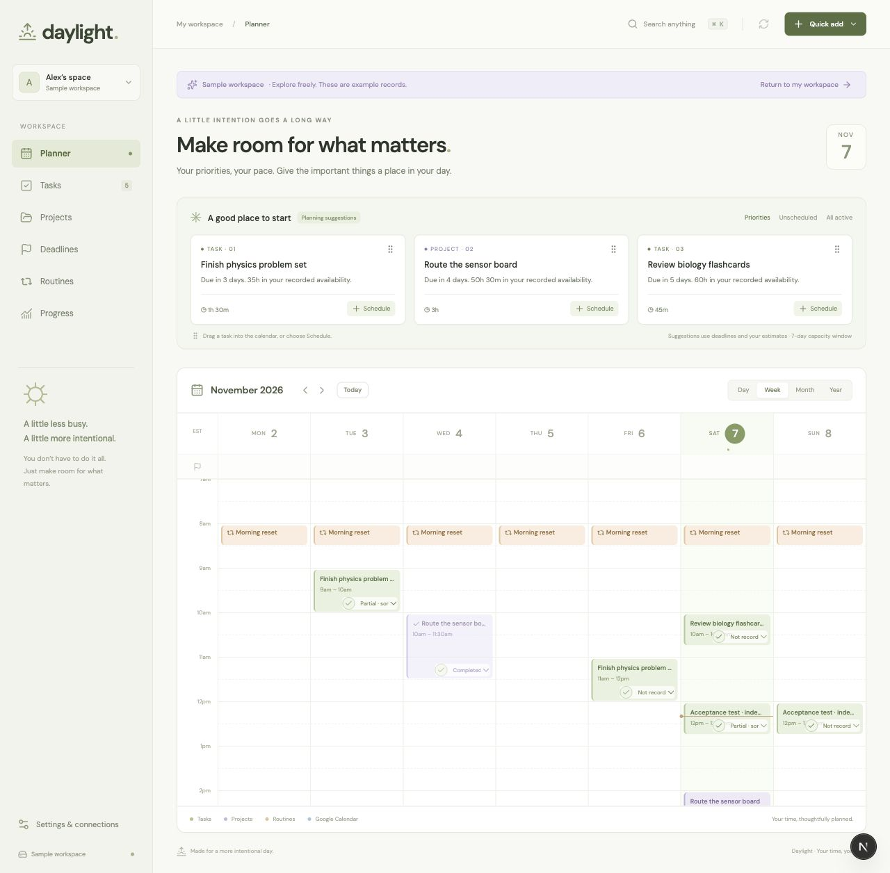

# Verification record

Verified locally on November 7, 2026. This document deliberately separates code, tests, browser behavior, and live integrations.

| Area                           | Status                                | Evidence / remaining limit                                                                                                                                                                                                                                                                                          |
| ------------------------------ | ------------------------------------- | ------------------------------------------------------------------------------------------------------------------------------------------------------------------------------------------------------------------------------------------------------------------------------------------------------------------- |
| Next.js production build       | Passed                                | Full application and API routes compile; no deployment performed.                                                                                                                                                                                                                                                   |
| TypeScript                     | Passed                                | Strict `tsc --noEmit`.                                                                                                                                                                                                                                                                                              |
| Automated tests                | Passed                                | 32 tests: record/session separation, recurrence, exceptions, markers, actual-time uncertainty, capacity overlaps, elapsed time, timed deadlines, competing deadlines, DST, imports, security, Gemini response validation, Google fixtures, and database migration.                                                  |
| Database migration             | Live applied                          | SQL Editor reported success. Read-only API check confirmed all three `daylight_*` tables, anonymous reads denied (401), and all six prior application tables still present.                                                                                                                                         |
| Database authorization         | Fixture tested                        | Local PostgreSQL runtime executed migration twice. Own-row visibility, other-user isolation, direct-write denial, compare-and-swap conflict rejection, and rate limits passed.                                                                                                                                      |
| Supabase configuration         | Live read verified                    | Project matches `.env.local`; existing site URL and `/auth/callback` redirect match local application. No existing URLs changed.                                                                                                                                                                                    |
| Authenticated cloud save       | Not live verified                     | Requires the user's application sign-in. Dashboard authentication is not an application user session.                                                                                                                                                                                                               |
| Desktop interface              | Browser checked                       | Planner, task editor, two independent sessions, unscheduled filtering, project approval, routine creation, and saved evidence review were exercised using isolated sample records.                                                                                                                                  |
| Local persistence              | Browser checked                       | Sample test tasks, sessions, review, and approval survived app reloads and re-entry to the sample workspace. Real local workspace stayed empty.                                                                                                                                                                     |
| Narrow interface               | Browser checked                       | 390px embedded viewport inspected; welcome banner wrapping was corrected. Planner is horizontally scrollable in Week view, with Day view and Schedule forms available on small screens.                                                                                                                             |
| Google API integration         | Source implemented, fixture tested    | OAuth/state protection, encrypted credentials, token refresh, calendar selection, RRULE/EXDATE generation, stable IDs, ownership checks, etags, and complete snapshot pagination. Fixtures verify retry idempotency, conflict preservation, and owned-only deletion.                                                |
| Live Google authorization/sync | Not live verified                     | User must sign in to Daylight and authorize Google; consent and redirect configuration cannot be inferred from env-key presence.                                                                                                                                                                                    |
| AI provider                    | Source implemented, not live verified | User selected Google Gemini and chose to add its API key later. Native REST adapter rejects incomplete/blocked output; live provider calls remain unverified. Routes validate outputs and task references. Daily reviews, milestone proposals, current-milestone task proposals, and priorities are request-driven. |
| Rules-based reviews            | Browser and fixture tested            | Explicitly labeled; retain snapshot, prompt/rule version, missing information, and self-report distinction.                                                                                                                                                                                                         |
| Existing project preservation  | Verified by scope and schema check    | No old tables or connection records changed; `.env.local` was not edited. Supplied references remain in place.                                                                                                                                                                                                      |

## Calendar follow-up

- The production build, TypeScript check, and 34 automated tests pass. New Google fixtures cover calendar and event pagination, the holiday toggle, holiday and free-event capacity, and deletion permission and concurrency checks.
- Browser checks at 1440px and 390px covered scheduling a task, its removal from Priorities and retention in All active, deletion of the session without confirmation, opening a holiday, changing the year, and selecting a date in Year Columns to open Day view.
- Calendar sync now imports the selected writable calendar plus visible holiday subscriptions. Deleting an imported event uses the selected occurrence and its synced version. Live Google authorization and deletion still need a signed-in test with a disposable event.

## Project hours, manual AI refresh, and Google event editing

- Production build, TypeScript, and all 39 tests passed. Provider fixtures cover read-only Gemini connection checks, Google event details, time-only updates, permissions, stale versions, recurring occurrences, all-day ranges, and daylight saving changes.
- An isolated browser workspace verified the hour fields, returning sessions by button and drag, opening event details, editing and dragging imported Google events, and retaining saved AI priorities after edits and reload. It also verified that local reviews and stale indicators make no generation requests, and that a manual refresh makes one.
- The configured Gemini key and model passed Google's read-only metadata request, and the local server reported the same configured model. No live generation or real Google Calendar writes were made in this check.

## Browser acceptance exercise

The sample workspace was used, not the user's real records:

1. Created a 90-minute task through Quick add.
2. Scheduled independent 45-minute sessions on two dates.
3. Marked only the first session Partial. The task remained active and the other session remained unconfirmed.
4. Confirmed the task disappeared from Unscheduled while remaining in Active with two sessions.
5. Saved a daily evidence review with self-reported Mixed focus and a one-sentence accomplishment. The report did not invent actual work duration.
6. Inspected an unapproved milestone, explicitly approved it, and verified its Approved state.
7. Created a 30-minute Monday/Wednesday/Thursday routine at 18:30.
8. Inspected the small-screen layout and corrected the welcome banner's wrapping.

## Material V1 boundaries

- Live OAuth and authenticated persistence must be verified using the user's own sign-in flow.
- Existing legacy table data is preserved but not automatically mapped into the new schema.
- One selected Google calendar, manual synchronization, conservative conflict handling, and no automatic schedule changes.
- Routine series edits can change historical calendar presentation; recorded outcomes remain in history. More elaborate recurrence policies are still open product decisions.
- Cloud documents and imports are capped at 5 MB; outgoing synchronization is capped at 500 Daylight records. Imported calendar snapshots are complete or rejected, never silently truncated.
- No claim of identical AI prose, measured attention, or automatic Gemini-chat access.

Final Gemini readiness check: Settings shows “API key needed” with Google Gemini selected. Browser console reported no warnings or errors. Production build and all 32 tests passed after the adapter change. The user elected to add the key later.

